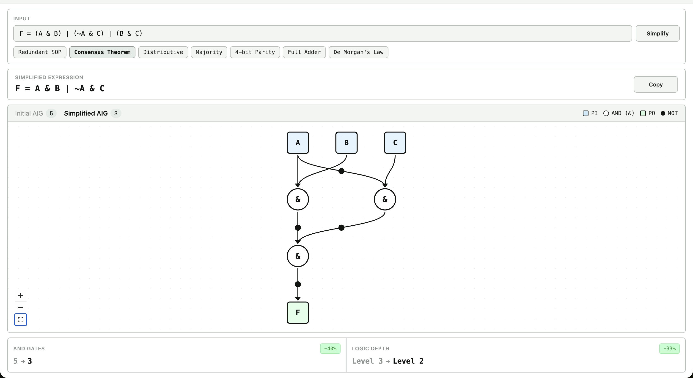

# AIG Studio


A simple And-Inverter Graph library in C++ for representing and manipulating Boolean functions used in logical synthesis and physical design to help optimise gate-level netlists in digital design. This project was intially written  after taking the course `Logical Synthesis and Physical` Design at the `Technical University of Munich`.

This library has been updated to include an interactive React + WebAssembly Studio for representing, optimising, verifying, and visualising Boolean logic networks in electronic design automation.




---

## Features

- **Multi-Format I/O:** Parse and export ASCII AIGER (`.aag`), binary AIGER (`.aig`), and BLIF (`.blif`).
- **Structural Hashing (**`strash`**):** Unique-table deduplication with on-the-fly constant folding and two-level algebraic reduction.
- **Dead-Node Sweeping (**`sweep`**):** Backward reachability pruning and duplicate gate merging.
- **Tree Balancing (**`balance`**):** Min-depth restructuring of associative AND and XOR cones.
- **DAG-Aware Rewriting (**`rewrite`**):** 4-input cut enumeration with a 16-bit optimal AIG database and MFFC gain evaluation.
- **Analysis & Visualisation:** Depth, fan-out, truth tables, equivalence checking, Graphviz DOT export, and ASCII cone trees.
- **Boolean Expression Engine:** Parse multi-output expressions (`*`, `+`/`|`, `^`, `~`/`!`/`'`) into JSON DAGs for CLI and web.

---

## Quick Start

Requires a C++17 compiler (GCC or Clang) and GNU Make.

```shell
make              # Build ./aig CLI
make test         # Build and run doctest unit suite
make show_stats FILE=examples/full_adder.aag
make truth_table FILE=examples/full_adder.aag
make tree FILE=examples/and2.aag
make dot FILE=examples/and2.aag OUT=examples/outputs/and2.dot
make optimize FILE=examples/and2_redundant.aag OUT=examples/outputs/and2_opt.aag
make simplify EXPR="(A * B) + (A * ~B)" PASSES="strash,balance,rewrite"
```

---

## CLI Usage

```shell
./aig stats       <file>            # Network statistics
./aig truth_table <file>            # Truth table simulation
./aig network     <file>            # Detailed node summary
./aig tree        <file>            # ASCII logic cone trees
./aig dot         <file> [out.dot]  # Export Graphviz DOT
./aig sweep       <file> [out.aag]  # Remove dead and duplicate nodes
./aig balance     <file> [out.aag]  # Minimize AND and XOR depth
./aig rewrite     <file> [out.aag]  # 4-input cut DAG rewriting
./aig optimize    <file> [out.aag]  # Full optimisation loop
./aig simplify    "<expr>" [passes] # Simplify Boolean expr to JSON DAG
./aig write       <file> <out.aag>  # Write ASCII AIGER (.aag)
./aig write_aig   <file> <out.aig>  # Write binary AIGER (.aig)
./aig write_blif  <file> <out.blif> # Write BLIF (.blif)
```

---

## GUI

```shell
make web-install   # Install web dependencies
make wasm          # Optional: compile C++ engine via Emscripten (em++)
make web           # Launch Vite dev server at http://localhost:5173
```


---

## Documentation

- [Library Notes](documentation/NOTES.md)
- [ASCII AIGER Format (.aag)](documentation/ASCII_AIGER_FORMAT.md)
- [Binary AIGER Format (.aig)](documentation/BINARY_AIGER_FORMAT.md)
- [BLIF Format (.blif)](documentation/BLIF_FORMAT.md)
- [Optimisation Theory](documentation/OPTIMISATION_THEORY.md)
- [Graph Export and Visualisation](documentation/GRAPH_EXPORT.md)
- [AIG Construction Examples](documentation/EXAMPLES.md)
